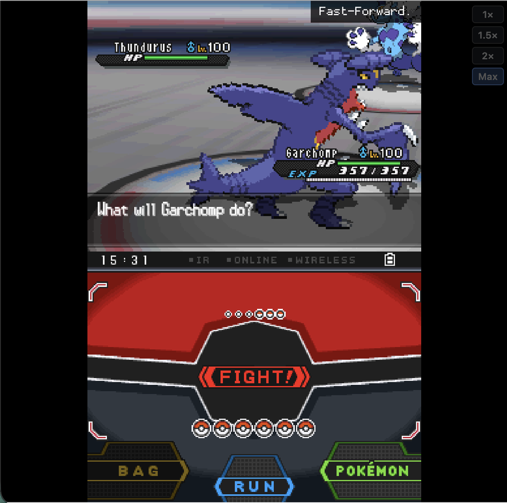
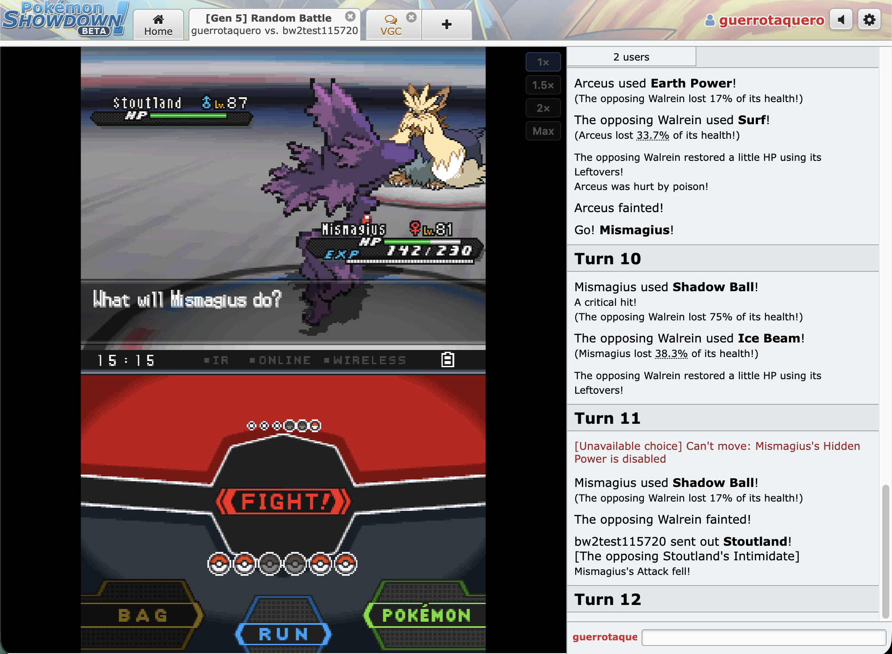

# Showdown in BW2

Play your Pokémon Showdown battles inside Pokémon Black 2.

A Chrome extension that runs Black 2 in an emulator right in Showdown. In your Gen 5
battles, BW2's own battle scene, animations and text replace Showdown's, and you pick your
moves and switches on BW2's touch screen. Showdown still runs the battle: every move,
roll and HP number is Showdown's, and BW2 only draws it.

<p align="center">
  
</p>
<p align="center">
  
</p>

## Install

1. Download `showdown-bw2-extension.zip` from the [latest release](../../releases/latest)
   and unzip it.
2. In Chrome, open `chrome://extensions`, turn on **Developer mode** (top right), click
   **Load unpacked**, and pick the unzipped folder.
3. Open [play.pokemonshowdown.com](https://play.pokemonshowdown.com). A panel in the
   bottom-right corner asks for your **Pokémon Black 2 ROM** (US version, `.nds`). Pick it
   once; it stays in your browser.

To update, download the new zip, replace the folder's contents with it, and press the
reload button (↻) on the extension's card in `chrome://extensions`. Chrome keeps running
the old version until you do.

## Use

- Start any **Gen 5** battle: Random Battle, OU, Doubles OU, and so on. It opens like a
  battle in the game: the trainers on screen, "would like to battle!", and both of them
  throwing out their first Pokémon. (A battle you join half-way through starts straight
  from where it is.)
- When it's your turn, tap **Fight** or **Pokémon** on BW2's touch screen with your mouse
  (or use the keyboard). Your pick is sent to Showdown.
- The buttons to the right of the game set its **speed** (1×, 1.5×, 2×, Max) and
  **mute** it.
- Team preview is picked in Showdown as usual; Showdown's own buttons come back for it and
  after the battle.

Good to know:

- Gen 5 battles are drawn faithfully, in singles and doubles. Later battles work too,
  including Gen 9 and Pokémon Champions VGC: later Pokémon, moves, abilities, items and
  Megas borrow the places of things those battles never use, with Showdown's Gen 5-style
  sprites and the closest Gen 5 animation, and lines BW2 doesn't have are shown in
  English.
- You need your own copy of the game; no ROM is included. The download includes
  savestates of Pokémon World Tournament battles, which BW2 needs to draw battles in.
- Tested with Chrome on macOS and the "251 Edition" of US Black 2, whose battle code is the
  same as the original game's.

Not affiliated with Nintendo, Game Freak, The Pokémon Company, or Pokémon Showdown.

## License and credits

GPL-3.0 (see `LICENSE`). Built on [EmulatorJS](https://github.com/EmulatorJS/EmulatorJS)
and its [melonDS](https://github.com/melonDS-emu/melonDS) core (both GPL-3.0), which ship
with it. BW2's battle internals come from [pokebw2](https://github.com/fuddlesworth/pokebw2),
a clean-room decompilation of Black 2. Move, item, ability and species data comes from
[Pokémon Showdown](https://github.com/smogon/pokemon-showdown) (MIT).

# For developers

The rest of this file is about working on the code: a web version of the app that runs
from a dev server, how the battle is drawn in BW2, and how the extension is built.

## Run it

```sh
npm install
npm run dev        # http://localhost:5173
npm test
```

To run the game in the page, choose your ROM under **Black 2 / White 2**, or let the dev
server hand it over, along with a savestate to jump to:

```sh
ROM=~/path/to/b2.nds STATE=savestates/battle-move-select.state npm run dev
```

(`SAVE=~/path/to/game.sav` loads a cartridge save instead.) Then press **Start**, and
click the page once, since browsers don't run the game before a click.

In the console:

- `window.bw.ram` is the game's main RAM (`read32`, `write16`, `bytes`, …),
  addressed like the DS, e.g. `0x02000000`.
- `window.bw.emulator.press('A')` presses a button.
- `await window.bw.keepState('name.state')` writes a savestate to `savestates/`.

Savestates need the same EmulatorJS version (4.2.3, in `public/emulatorjs`).
`savestates/` is git-ignored. It holds:

| File | Where it starts |
|---|---|
| `pwt-outside.state` | Inside the PWT, by the arena doors, with a Lv 50 team (made with PWT Unlocked's `pwt new`) |
| `battle-move-select.state` | Driftveil Tournament, round 1: Garchomp vs. Golduck at "What will Garchomp do?" |
| `battle-doubles.state` | Rental Tournament, Double Battle, round 1: Golett and Tirtouga vs. Vanillite and Lampent at "What will Golett do?" |
| `intro-singles.state` | Rental Tournament, Single Battle, round 1: the announcer's last line before the battle starts |
| `intro-doubles.state` | Rental Tournament, Double Battle, round 1: the same, for doubles |

A battle shown from its start begins with BW2's own intro. From `intro-*.state`, the app
starts the battle, and as soon as BW2 has built it (before its intro shows anyone) renames
the trainers and writes the Showdown leads into their party slots. It also takes the
abilities and items off BW2's own copies of the Pokémon, so its logic shows no entry
effects of its own. BW2 then plays its intro (trainers, throws, "Go! X!"), and at turn 1's
menu the app pauses its logic and leaves the menu open for the first choice. A battle
joined half-way uses the `battle-*.state` savestates instead.

A doubles battle on Showdown switches the game to `battle-doubles.state` on its own, and
a singles battle switches it back to the dev server's `STATE`.

## The browser extension

The extension puts BW2 inside Showdown itself: in each of your battles, BW2's top screen
takes the place of Showdown's battle scene, and its touch screen opens below when it's
your turn to choose. It needs no dev server, relay or userscript.

```sh
npm run build:extension   # needs the four savestates below in savestates/
```

The savestates aren't in the repository; take them from the release zip (its `savestates/`
folder) or make your own with the web version (see below).

Then in Chrome, open `chrome://extensions`, turn on **Developer mode**, press **Load
unpacked**, and pick the `dist-extension` folder. (After rebuilding, press the reload
button on the extension's card.) On Showdown, the extension asks for your Black 2 ROM
once, in the corner, and keeps it in the browser.

| File | What it does |
|---|---|
| `extension/tap.js` | Runs in the Showdown page from the start: copies its messages, sends `/choose` commands |
| `extension/embed.js` | Frames the app over the battle scene of the battle it's showing, and relays messages |
| `extension/app.html`, `src/ext/app.ts` | The app without the preview, fed by the page; the ROM lives in its IndexedDB |
| `extension/emu.html`, `extension/core-files.js` | The emulator frame. Extension pages can't run `blob:` scripts, which is how EmulatorJS unpacks and loads its core, so the build unpacks it ahead of time and `core-files.js` loads it from files |
| `scripts/build-extension.mjs` | Builds `dist-extension/`: the app (`vite.extension.config.ts`), EmulatorJS with only melonDS, the unpacked core, the savestates |

`src/game.ts` (booting, taking over, switching and restarting battles) is shared by the
web page and the extension.

## Where battles come from

- **Watch a live battle:** paste a battle link. The page joins Showdown as a guest
  spectator. If you join mid-battle, earlier turns are drawn instantly and only new ones
  animate.
- **Play a replay:** paste a `replay.pokemonshowdown.com` link.
- **Your own battles:** install `/showdown-tap.user.js` from the running app in
  Tampermonkey or Violentmonkey. It copies your Showdown tab's messages to the dev
  server's `/relay`, and your newest battle takes over the screen with your side drawn
  near. This also covers hidden battles that spectators can't join. Chrome may ask
  whether play.pokemonshowdown.com can reach devices on your local network; allow it.

Gen 5 formats are drawn faithfully. Later ones (Gen 9, Pokémon Champions) borrow BW2's
slots for what it lacks: later Pokémon and Megas get Showdown's Gen 5-style sprites, and a
Mega Evolution rewrites the Pokémon's party record as its Mega's slot before BW2 changes
its form, which redraws it from that record.

## How it works

```
Showdown messages ─▶ Session ─▶ Translator ─▶ Commands ─▶ Director ─▶ Renderer
  (spectate / replay /  one per     protocol →      bw/commands.ts   one at a    preview now,
   userscript relay)    battle room  BW2 order                       time        emulator next
```

| File | What it does |
|---|---|
| `src/showdown/protocol.ts` | Parses protocol lines, Pokémon refs, details and HP |
| `src/translate.ts` | Turns protocol into `Command`s in the order BW2 shows things: HP drops before "It's super effective!", ability popups before their effect, and withdrawal before a switch-in |
| `src/bw/commands.ts` | Everything a renderer must be able to show |
| `src/bw/english.ts` | BW2-style battle text for the preview |
| `src/session.ts` | Routes messages to battle rooms, follows the newest battle, catches up on battles joined mid-way |
| `src/director.ts` | Queues commands so each one finishes before the next |
| `src/preview.ts` | The stand-in renderer |
| `src/emu/emulator.ts`, `public/emu.html` | EmulatorJS (melonDS) in an iframe |
| `src/emu/ram.ts` | Finds the DS's main RAM in the emulator's heap; reads and writes it |
| `src/sources.ts` | Spectating, replays, the relay client |
| `vite.config.ts` | The `/relay` websocket (accepts taps only from Showdown origins) |
| `public/showdown-tap.user.js` | The userscript |

Tests run the translator and the BW2 scene over real Gen 5 OU and Doubles OU replays in
`test/fixtures/`. `test/gaps.test.ts` keeps a list of anything BW2 can't show yet (it's
empty now), and the app lists the same for the battle on screen. `test/gen9.test.ts` and
`test/champions.test.ts` do the same for Gen 9 and Pokémon Champions VGC replays, and list
the lines shown in English.

`scripts/` has tools for testing without a second person:

- `node scripts/showdown-opponent.mjs <your name> [format] [--forfeit-at <turn>]` joins
  Showdown under an unregistered name and plays the other side, picking random moves.
  Showdown doesn't let unregistered names send challenges, so you challenge it (the name
  it prints). For formats that aren't random it brings a Gen 5 team; use the same one
  on your side (it's `TEAM` in the script).
- `scripts/fake-showdown.mjs` stands in for Showdown and the userscript entirely.
- `scripts/dumptext.py <rom> <dir>` dumps the ROM's text banks, which is where the
  message IDs in `src/emu/messages.ts` come from. `scripts/data/` (git-ignored) holds the
  battle banks.

## Playing from BW2

In your own battles, when Showdown asks you to choose, BW2's own menus open. You can tap
Fight and a move, or Pokémon and a switch, with the mouse on the touch screen, or use the
keyboard. Your pick goes back to Showdown as `/choose`. In doubles, BW2 asks for both
Pokémon and their targets.

1. Install `/showdown-tap.user.js` (v0.2.0 or later) and battle in a logged-in Showdown
   tab. Pick your lead at team preview in that tab.
2. In the app, start BW2 and let it take over the savestate battle.
3. From the first turn on, choose in the game. The Showdown tab still works too, and
   whichever choice reaches Showdown first counts.

How it works (`src/play.ts`, `src/emu/bw2.ts`):

- **Your team.** On the first request after team preview, the app writes your whole team
  into BW2's party: species, nickname, level, HP, status and moves. The PWT battle only
  built three battle Pokémon per side, so slots 4–6 borrow the paused server's own
  `BattleMon`s. Their records move into the client's `PokeParty`, and its count goes
  to 6, which the Pokémon menu reads. HP IVs and EVs are chosen so that the game's own
  stat formula gives Showdown's max HP.
- **The menu.** Once a request's turn has finished playing (the director is idle and
  Showdown has been quiet for 0.7 s), the app writes the active Pokémon's moves and PP.
  Then it hands the client `BTL_ACMD_SELECT_ACTION`, or `BTL_ACMD_SELECT_CHANGE_FAINTED`
  for a forced switch. The client runs its normal menu and answers with a
  `BattleAction`.
- **The choice.** A fight carries the move's number, which matches the request's move
  slot, and a target battle position. A switch carries a party slot, which maps to the
  Showdown Pokémon written there. The choice goes out as `room|/choose move N|rqid` or
  `switch N` through the relay, and the userscript sends it with the Showdown client's
  own `app.send`. In doubles there's one part per position (`move 1 2, switch 4`):
  targets are Showdown's (foes 1 and 2, allies −1 and −2) and only go with moves that
  take one, and a position with nothing to choose passes. Bag and Run have no Showdown
  equivalent: you're asked again.
- **Menus nobody needs any more.** A menu opened for a request that has been replaced,
  or still open when the battle ends, is closed by answering it (pressing A), so the
  game cleans up after itself. Requests from the relay's backlog (history replayed when
  the page loads) don't open menus.

Mouse taps need the core's `melonds_touch_mode` set to `Touch`, which `public/emu.html`
does by default. A tap has to last a frame or so, like a real click; instant synthetic
clicks (from browser automation) don't register.

Checked live against a real, logged-in Showdown tab (with `scripts/showdown-opponent.mjs`
on the other side): in Gen 5 Random Battle, a move, a switch and a forced switch after a
faint, all picked in BW2's menus; in Gen 5 Doubles OU, moves with picked targets for
both Pokémon.

The game keeps running while its tab is hidden (say, while you watch your Showdown tab).
`public/emu.html` tells RetroArch the page is always visible, since it pauses otherwise,
and while the page is really hidden the core gets its frames from a worker's timer
(timers in a hidden page itself are throttled to a tick a second or less). The bridge's
timeouts count the game's frames, so a paused game never gets commands skipped.

## Drawing in BW2

BW2's battle is split in two. The logic side (the server) packs display commands into a
byte queue (`SC_MOVE_ANIM`, `SC_DAMAGE`, `SC_SEND_OUT`, …). The client side reads that
queue and calls the battle view. In a local battle they share an adapter in RAM: the
server writes a command there, and the client runs it and sets `returned`.

`src/emu/bw2.ts` takes that over:

1. It finds the player's client by its pointer to the adapter (`sAdapters` at
   `0x021dd86c`) and its main loop (`0x021b19d5`). From there it reaches the main module
   and the server.
2. It sets the server's `state` to 2, which leaves BW2's own battle logic doing nothing.
3. If the move menu is open, it answers the menu, so the menu closes the normal way and
   the client goes idle.
4. For each command, it writes a `BTL_ACMD_SERVER_CMD` block (packed by
   `src/bw/servercmd.ts`) into the adapter and clears `returned`. The client plays the
   block with the game's own handlers, and the bridge waits until it answers.

With the dev server started with `STATE=savestates/battle-move-select.state`, this
happens on its own once the game runs. In any other battle, press **Take over this
battle**. The director then plays every command in both the preview and the game.

Before taking over, the app keeps a snapshot of the game. When Showdown's battle ends,
BW2 shows its own result (the victory music, then "Player defeated PKMN Trainer X!",
"lost against" or "battled to a draw"; "Player" is literal in this ROM's text), and a few
seconds later the game goes back to that snapshot, ready for the next battle. So the game
never leaves a battle and never saves the rewritten party.

`src/emu/scene.ts` turns each command into BW2 server commands, in the order BW2's own
server sends them. It keeps a copy of BW2's side of things: party order by mon ID, HP in
BW2's units, and which positions have a Pokémon on screen.

| Showdown event | In BW2 |
|---|---|
| Battle start | Both trainers renamed to the Showdown players (`src/emu/trainers.ts`): "PKMN Trainer X sent out Y!" |
| Switch in | Rewrites a benched party slot with the Showdown Pokémon (`src/emu/party.ts`), then `OP_SEND_IN` + `SEND_OUT`: real sprite (species, form, gender, shiny), nickname, level, HP and status in the HP box, "Go! X!" |
| Switch out | `RECALL_MSG` + `RECALL` |
| Move | "X used Y!" (`MOVE_MSG`), then the move's animation |
| HP change | `OP_SUBTRACT_HP`/`OP_ADD_HP`, then `DAMAGE` (hit flash and the effectiveness sound) or the gauge alone, then the cause's line (Stealth Rock, burn, Leftovers, …) |
| Faint | The gauge empties, "X fainted!", and the faint animation |
| Status | Condition, gauge icon, the status animation and its line; cures too |
| Stat changes | `OP_RAISE/LOWER_STAT_STAGE`, the stat effect, "X's Attack rose sharply!" |
| Ability | The ability popup with the right ability |
| Weather | Start and end with the game's own animation and text; a replay of the animation each turn |
| Battle text | Crits, effectiveness, misses, Protect, confusion, Substitute, hazards, can't-move reasons, … from the ROM's text banks (`src/emu/messages.ts`) |
| Items | Reveals and losses: Air Balloon, Frisk, Trick, Thief, Knock Off, Focus Sash, Eject Button, damage-halving berries |
| Field and sides | Trick Room, Gravity, Magic Room, Wonder Room; Reflect, Light Screen, Safeguard, Mist, Tailwind, Lucky Chant |
| Volatiles | Taunt, Encore, Disable, Torment, Yawn, Attract, Ingrain, Aqua Ring, Magnet Rise, Curse, Perish Song, Stockpile, Illusion; their can't-move lines |
| Charge turns | Fly, Dig, Dive, Bounce, Shadow Force, Solar Beam, Skull Bash, Sky Attack, … |
| Battle end | The victory music and the result line |

Joining a battle midway applies its history to BW2's battle data only, then sends the
right Pokémon out before the first new animation.

Writing a party slot follows BW2's in-RAM format: the PK5 record is written plain, with
flags 0x0003 meaning "already decrypted" and a PID whose bits 13–17 are clear so the blocks
stay in order. Gender comes from the PID against the species' gender ratio, and shininess
from the IDs. Species data (gender ratio, growth rate, first ability) is read from the
ROM's `a/0/1/6` at boot (`src/emu/rom.ts`).

Trainer names longer than the PWT's own don't fit its name buffer, so they go into
buffers of ours in the paused server's command queue (unused while it's paused), and the
original pointers go back before the game would free them.

### Changing the cart while the game runs

To show what BW2 doesn't have, like later Pokémon, moves and the Fairy type,
the app rewrites the game's files as the game reads them: in melonDS's copy of
the ROM in the WebAssembly heap (`src/emu/romimage.ts`). Each write goes to
every copy of the ROM found there. Nothing changes in the game's code. What
was found out live, starting from the PWT savestates:

- **Sprites** (`a/0/0/4`, 20 files per species) are read from the cart on each
  send-out, through its archive table. A replaced file that doesn't fit goes
  into 16 MB of room added at the end of the ROM before it boots. The archive
  is stretched to the ROM's end in the file allocation table, and in the copy of
  that table the game keeps in RAM. A savestate brings the old copy back, so
  `Emulator.loadState` stretches it again each time.
- **Text** is read from the cart for each message, but the game holds its text
  banks open and remembers where each one starts, so a bank can't move or
  grow. A longer line goes into the bytes of lines that won't be shown
  (`src/emu/text.ts`). Each line's key is 0x7C89 + 0x2983 × its number,
  rotated left 3 bits per character.
- **Move data** (`a/0/2/1`), meaning type, category and PP, is read when the
  action menu opens, and so is the move's name (bank 403). Type 17 doesn't
  exist in BW2: the menu draws the contest "Cool" icon (the next one in the
  sheet) on a black button.

Limits:
- **Singles and doubles only.** There are no triples or rotation savestates.
- **The opponent's sprite is still the PWT trainer's**, though the name is Showdown's.
- **Spread moves** animate toward their first target, and each target's hit flashes in
  turn rather than all at once.
- **Some lines are missing.** Lines Gen 5 doesn't have show only in the preview; the app
  lists anything else BW2 couldn't show for the battle on screen.
- **Unreadable names** (e.g. Chinese) show as the species name, or "Player"/"Opponent"
  for trainers, since the US game's font has Latin letters only.

Names and addresses come from [pokebw2](https://github.com/fuddlesworth/pokebw2), a
clean-room decompilation of Black 2 (overlay 167: logic, client, `btlv_core`; overlay
168: effects, sprites, gauges). Struct offsets were read from the game's own
instructions. The "251 Edition" ROM's overlays 167 and 168 load at the same addresses
with the same sizes as the clean game, and all 20,700 call sites and pointers that
pokebw2 lists for them match.
